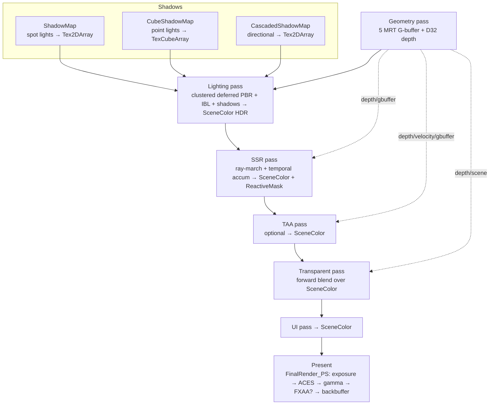

# DX12Engine — 3D Rendering Architecture: A Deep Analysis

*A technical report on how the renderer works, how it compares to other engines, where it is strong, where it is weak, the bugs it currently carries, and where it should go next.*

---

## 1. Executive summary

DX12Engine is a **clustered, deferred, physically-based renderer** built directly on Direct3D 12 with a data-driven, frame-graph-lite pass system. For a single-author/learning-oriented engine it is unusually complete: it ships a full G-buffer deferred pipeline, image-based lighting with a clearcoat lobe, three shadowing techniques (spot 2D, point cube, cascaded directional), screen-space reflections with temporal accumulation, a hand-written TAA resolve with variance clipping and dilated velocity, ACES tone mapping, discrete LOD selection with hysteresis, frustum culling, and a data-driven render-pass graph that automatically wires producers to consumers and re-creates transient targets on resize.

The technique *quality* is well above the typical tutorial renderer and lands somewhere in the **intermediate-to-advanced hobby** tier. Every execution-layer ceiling this report originally named has since been lifted: the submission model is pipelined `FRAMES_IN_FLIGHT` deep (§3.2), dynamic constants come from a per-frame ring (§10.3), uploads are fence-based instead of CPU-blocking (§3.3), the G-buffer is 32 bytes/pixel (§4.1), lighting is **clustered** with no fixed light cap (§5), tone mapping and reverse-Z are in, and all five documented bugs are fixed (§15).

What separates it from a production engine now is **scale machinery rather than correctness**: cluster assignment is single-threaded CPU work, no compute shader ships at all, there is no GPU-driven submission or occlusion culling, and no global illumination beyond SSR.

The rest of this document walks the pipeline in detail, then collects strengths, weaknesses, the bugs it carried (all now fixed), and a roadmap.

---

## 2. The frame at a glance

The demo (`DemoScene/src/DX12EngineDemoApp.cpp:154`) builds this pass graph, executed in order by `Renderer::ExecutePipeline` (`src/DX12Engine/Rendering/Renderer.cpp:205`):



Key structural facts:

- **Deferred core, forward tail.** Opaque geometry is deferred (G-buffer → single full-screen lighting resolve). Transparent geometry is drawn afterward in a **forward** pass that copies the resolved scene and alpha-blends over it (`TransparentRenderPass.cpp:78`).
- **Post-order.** SSR and TAA operate on the HDR `SceneColor` before transparents. Transparents therefore receive **no TAA and no SSR** — a deliberate, common tradeoff (transparents lack motion vectors), but worth knowing.
- **Present is a blit.** The final image is produced by a full-screen triangle in `Renderer::PresentFrame` running `FinalRender_PS` (exposure → ACES → gamma, then optional FXAA), sampling the last pass's `Composite` target (`Renderer.cpp:588`).

---

## 3. Device, swap chain, and the frame lifecycle

### 3.1 Setup
`RenderContext` creates the device at **feature level 11.0** (`RenderContext.cpp:52`), a `CommandQueueManager`, a `DescriptorHeapManager`, and a `GPUUploader`. The swap chain is **double-buffered, `FLIP_DISCARD`, `R8G8B8A8_UNORM`, windowed, vsync on** (`RenderWindow.cpp:63`, `Present(1,0)` at `RenderWindow.cpp:128`).

### 3.2 The submission model

Each render pass records into the graphics queue's command list and **submits its own command list** at the end of `Execute()` (e.g. `GeometryRenderPass.cpp:164`, `LightingRenderPass.cpp:108`). The next pass calls `ResetCommandAllocatorAndList()` (`RenderPass::Execute`, `RenderPass.cpp:79`), which rotates through a pool of `COMMAND_ALLOCATOR_POOL_SIZE` allocators (`FRAMES_IN_FLIGHT * 32`, `Constants.h:5`) and only CPU-waits if none is free.

Frames are **pipelined `FRAMES_IN_FLIGHT` deep** (2 today). The only per-frame CPU wait is at the *top* of the frame, in `Renderer::ExecutePipeline` (`Renderer.cpp:208`):

```cpp
UINT currentSlot = m_FrameIndex % FRAMES_IN_FLIGHT;
if (m_FrameFenceValues[currentSlot] != 0)
    m_QueueManager.GetGraphicsQueue().WaitForFenceCPUBlocking(m_FrameFenceValues[currentSlot]);
```

The CPU therefore blocks on the frame that last used *this slot's* resources — not on the frame it just submitted. `PresentFrame` records the frame's completion fence into `m_FrameFenceValues[slot]` and presents without waiting (`Renderer.cpp:623`), so the CPU records frame N+1 while the GPU executes frame N.

Everything the CPU writes and the GPU reads within a frame is slot-indexed behind that gate: the constant ring (`FrameConstantAllocator`, §10.3), `ConstantBuffer`'s `s_FrameSlot` sub-allocation, the command-allocator pool, and the transient descriptor heap. All of them size themselves from `FRAMES_IN_FLIGHT`, so deepening the pipeline is a one-constant change. The corollary is the rule for new code: **a single-buffered upload resource rewritten every frame is a race under this model** — put per-frame data through the ring, or N-buffer it the same way.

(This section previously described a full `WaitForFenceCPUBlocking` after `Present` and an effectively single-frame-in-flight engine. That stall is gone; see `docs/Frame-Pipelining-Guide.md` for how it was removed.)

### 3.3 Uploads are asynchronous
`GPUUploader` records copies on the **copy queue** and the acquiring barriers on the **graphics queue** through two independent `UploadCommandList`s, submits both, and returns without waiting. Each list owns a pool of allocator slots and CPU-waits only when every slot is still in flight (`UploadCommandList::Begin`, `GPUUploader.cpp:209`). Upload heaps and the resources they feed are retired against the graphics fence (`ProcessRetiredResources`), so staging memory is reclaimed without a stall and a first-sighting texture no longer freezes the frame that discovers it.

**Net:** the frame pipelines and streaming does not hitch. What is left on the CPU each frame is single-threaded pass recording, per-object culling/LOD (§11), and cluster assignment (§5).

---

## 4. Geometry pass and the G-buffer

### 4.1 Layout
`GeometryRenderPass::Init` (`GeometryRenderPass.cpp:29`) creates **five color render targets plus a depth target**:

| Slot | Format | Bytes/px | Contents |
|------|--------|---------:|----------|
| Albedo | `R8G8B8A8_UNORM` | 4 | base color (linearized), alpha |
| Normals | `R16G16B16A16_UNORM` | 8 | octahedral world normal in `.xy`, geometric normal in `.zw` |
| Material | `R8G8B8A8_UNORM` | 4 | roughness, metallic, clearcoat, clearcoatRoughness |
| Emissive | `R16G16B16A16_FLOAT` | 8 | emissive rgb + **AO in alpha** |
| Velocity | `R16G16_FLOAT` | 4 | screen-space motion vector |
| Depth | `D32_FLOAT` | 4 | hardware depth, **reverse-Z** (near → 1.0, far → 0.0, `GREATER` test) |

**Total ≈ 32 bytes/pixel.** At 1080p that is **~66 MB** for the G-buffer, before SceneColor, two SSR history buffers, two TAA history buffers, the reactive mask, and the transparent scene copy — all full-resolution `R16G16B16A16_FLOAT`.

This layout is the result of the slimming pass described in `docs/GBuffer-Slimming-Guide.md`, which took it from 8 targets at 52 bytes/pixel (~107 MB at 1080p):

- **Position was deleted.** World position is reconstructed from depth and the inverse projection by `ReconstructWorldPos` in `Shaders/Common/GBufferUtils.hlsli`, shared by the lighting and SSR passes. This is also a *precision* win: half-float world coordinates quantise to worse than a unit past a few thousand units from the origin, while `D32_FLOAT` run back through the inverse projection stays sub-millimetre.
- **The two normal targets became one.** Both normals are octahedral-encoded to two channels (`PackNormal`/`UnpackNormal`, same header) and share a single `R16G16B16A16_UNORM` target. `UNORM` rather than `FLOAT16` because octahedral mapping wants uniform precision across its range, not exponent range it will never use; angular error is ~0.1° at 16 bits.
- **Material narrowed to `RGBA8`.** All four channels are `[0,1]` and every consumer already `saturate()`s them on read.

Because oct pairs must not be filtered — interpolating them across a silhouette or the fold decodes to a direction belonging to neither surface — G-buffer normal fetches go through the `LoadMap`/`LoadWorldNormal` point-load helpers rather than the pass's anisotropic sampler.

Each render-target format is declared in **three** places that must agree: the `RenderTextureConfig` in `GeometryRenderPass::Init`, the `SetRenderTargets` list in `GeometryRenderPass::CreatePSO`, and a duplicate of that list in `MaterialTemplate::BuildPSODesc` (`MaterialTemplate.cpp:109`). A mismatch in the third fails per-material and reads as a material bug.

### 4.2 Vertex path and motion vectors
`Geometry_VS` (`Shaders/Geometry_VS.hlsl`) transforms with a jittered `MVPMatrix` for rasterization but carries **both** an *unjittered* current clip and the previous-frame unjittered clip. `Geometry_PS` computes the velocity from the **unjittered** current/previous NDC (`Geometry_PS.hlsl:101`). This is the correct way to avoid baking TAA jitter into motion vectors — a genuinely nice detail. The previous-MVP is tracked per primitive binding, and reset when the object was frustum-culled last frame (`Renderer.cpp:476`) so re-appearing objects don't emit a bogus velocity spike.

Tangent space uses a stored handedness sign (`Vertex.Tangent.w`) and reconstructs the bitangent with `cross(N,T)*w` (`Geometry_VS.hlsl:49`), so mirrored UVs are handled correctly.

### 4.3 Draw submission
`Renderer::SetSceneData` builds `DrawItem`s and sorts opaque items by **(PSO key, material, mesh, CBV address)** (`Renderer.cpp:511`) to minimize state changes, shadow items the same way, and transparent items **back-to-front by object-center distance** (`Renderer.cpp:526`). The geometry pass then binds lazily, skipping redundant PSO/root-sig/CBV/material/VB-IB sets (`GeometryRenderPass.cpp:92`). This is textbook sort-then-batch and is done well. Materials can carry their own PSO variant via `MaterialTemplate`, falling back to the pass's default PSO when none is resolved.

---

## 5. Shading model (deferred PBR + IBL)

The resolve is `PBRLightingDeferred_PS` (`Shaders/PBRLightingDeferred_PS.hlsl`) drawn as a single full-screen triangle.

**Analytic lighting** (`PBRShading.hlsli`) is standard Cook-Torrance: GGX/Trowbridge-Reitz NDF, Schlick-GGX geometry with the `(r+1)²/8` direct-lighting `k`, Schlick Fresnel, `F0 = lerp(0.04, albedo, metallic)`. On top of the base lobe there is a **glTF-style clearcoat** second specular lobe with fixed `F0≈0.04` and base-layer energy attenuation (`ClearcoatSpecLobe`). This is a real, correct extension most hobby engines never add.

**Image-based lighting:** diffuse from an irradiance cubemap, specular from the environment cubemap sampled at `roughness*12` mip (`PBRLightingDeferred_PS.hlsl:124`), Fresnel-roughness split, plus a **specular-occlusion** term (`SpecularOcclusion`) that keeps polished metals from glowing in shadow. The environment reflection is a prefiltered-mip approximation rather than a proper split-sum BRDF LUT.

**Light types:** directional (with CSM), point (inverse-square with a windowing falloff, cube-array PCF shadow), spot (cone falloff, 2D PCF shadow). Shadow sampling is gated on `light.ShadowMapIndex >= 0`, so a light with no atlas slot (§6) simply shades unshadowed rather than reading a stranger's map. Only the directional cascade feeds the **"ambient shadow"** term that darkens IBL through a smooth remap (`PBRLightingDeferred_PS.hlsl:147`) — a pragmatic hack to fake shadowing of ambient light without an AO/GI pass, deliberately limited to the sun because a local light's shadow map says nothing about how much environment reaches a surface.

**Sky:** pixels at far depth (reverse-Z: `depth <= 0`) sample the environment cubemap directly (`PBRLightingDeferred_PS.hlsl:112`).

### Clustered light assignment

Lights live in a runtime-sized `StructuredBuffer<LightData>` bound at `t0, space1` — there is no compile-time light cap. `LightBuffer::Update` uploads directional lights first and everything else after (`LightBuffer.cpp:18`), which is what lets the shader split its loop into "always shade" and "shade if the cluster lists it".

`ClusteredLightGrid` (`Rendering/Lighting/ClusteredLightGrid.cpp`) divides the view frustum into **16 × 9 × 24 froxels** (`LIGHT_CLUSTER_GRID_*`, `Constants.h:12`): screen-space tiles in x/y, **exponentially spaced slices** in z, `z_k = near · (far/near)^(k/24)`. Exponential slicing keeps each slice's depth range proportional to its distance instead of packing almost every froxel into the first few metres, which is what makes a single 24-deep grid usable across the whole near-to-far range. The slice index is therefore a logarithm, precomputed as a scale/bias pair (`DepthScale`, `DepthBias`) shared verbatim by CPU and shader.

Froxel AABBs are view-space and depend only on FOV, aspect and the near/far planes, so they are cached and rebuilt only when one of those changes (`RebuildFroxelBounds`) — camera movement does not invalidate them. Each AABB takes the min/max over **both** z planes of the froxel, because a perspective froxel's near face is smaller than its far face and the corners of one do not bound the other.

Per frame, every non-directional light's bounding sphere is tested against the froxels within its slice range (`SphereIntersectsAABB`), and the per-froxel buckets are flattened into two more buffers: `ClusterGrid` (`t1, space1`, one `uint2` offset/count per froxel) and `LightIndices` (`t2, space1`, the flat index list, capped at `MAX_LIGHT_INDICES` = 32 × froxel count). Those two, the light list, and the `ClusterData` cbuffer that carries grid size, tile size, depth scale/bias and the directional count all go through the per-frame constant ring (§10.3) and are bound as **root SRVs / root CBV**. Clustering therefore consumes **no descriptors at all** and moved no existing register — the deliberate design choice that kept the change out of the descriptor-heap code entirely.

The shader half is `Shaders/Lighting/ClusteredLighting.hlsli`, shared by the deferred and transparent pixel shaders: `GetClusterIndex(SV_POSITION.xy, viewZ)` resolves the froxel, and shading runs the directional lights unconditionally, then only the lights that froxel lists (`PBRLightingDeferred_PS.hlsl:138`). The transparent pass reads the same three buffers and derives its `viewZ` from the interpolated world position rather than `SV_POSITION.w`.

**What this buys and what it costs.** Shading cost stops scaling with *total* light count and starts scaling with *local* light density, so hundreds of short-range lights cost little more than a handful — that is the whole point of the exercise. The costs are that assignment is **single-threaded CPU work** proportional to lights × froxels touched, and that a froxel whose bucket exhausts `MAX_LIGHT_INDICES` silently drops the overflow. Both are instrumented: a `_DEBUG` print every 60 frames reports peak lights per cluster, index-list high-water mark, dropped count and froxel rebuilds (`Renderer.cpp:646`), and `RendererOptions::ShowLightGridHeatmap` (`RendererOptions.h:69`, exposed as an ImGui checkbox) returns a per-froxel occupancy ramp instead of shading. Moving assignment to a compute shader is the natural next step (§16 item 10).

### Gaps in the shading model
- **No BRDF integration LUT** (split-sum): the env specular is `prefiltered * kS * (1-roughness)²`, an ad-hoc energy term rather than the standard `prefiltered * (F0*scale + bias)`. Visually plausible, not energy-correct.
- **Transparents are lit but never shadowed.** The transparent pass consumes the cluster buffers and calls the same `PBRLighting`, but binds no shadow atlases and no CSM constants, so every light contributes unshadowed there. It also adds its analytic result at a reduced weight so transmission and refraction keep dominating the look.
- **`sRGBToLinear` uses `pow(x,2.2)`** rather than the exact piecewise sRGB curve — universally fine, just noting it.

---

## 6. Shadows

Three separate systems feed the lighting pass:

**Spot lights → `ShadowMapRenderPass` (2D).** One `SHADOW_MAP_SIZE = 2048` slice of a `Texture2DArray` per spot light (`ShadowMapRenderPass.cpp:34`), rendered with a fixed depth bias (const 1000, slope 1.5) and `CULL_MODE_NONE`. Sampled with a **16-tap Poisson-disk PCF** comparison sampler (`ShadowSampling.hlsli:4`).

**Point lights → cube shadow.** Six `LookAtLH` faces per shadow-casting point light rendered into slices of a cube *array* (sampled as `TextureCubeArray`, §15 Bug 3), distance stored normalized by far plane; sampled with a 3×3 PCF (`ShadowSampling.hlsli:47`).

**Directional → `CascadedShadowMapRenderPass`.** This is the most sophisticated piece. It computes **logarithmic/uniform blended split distances** (`SplitLambda`), fits each cascade to its frustum-slice bounding sphere, and applies **texel-snapping** (rounding the light-space center to whole texels, `CascadedShadowMapRenderPass.cpp:250`) to kill shadow swimming under camera motion. Sampling (`CascadedShadowSampling.hlsli`) uses per-cascade normal bias + slope-scaled depth bias, 16-tap Poisson PCF, and **smooth inter-cascade blending** across a configurable band. This is production-grade CSM logic.

### Shadow issues
- **Shadow slots are capped per light type and handed out first-come-first-served.** `MAX_SHADOW_CASTING_SPOT_LIGHTS` and `MAX_SHADOW_CASTING_POINT_LIGHTS` (4 each, `Constants.h:17`) bound the atlases; `LightBuffer::AddLight` (`LightBuffer.cpp:40`) assigns a slot in creation order and gives everything past the cap `ShadowMapIndex = -1`. This cap is **load-bearing** — without it a 256-light scene would ask for 256 cube maps at `SHADOW_MAP_SIZE = 2048` and remove the device — but the policy is arrival order, not importance, so a scene that creates its hero caster late loses that shadow.
- **Transparents receive no shadows at all** (§5).
- **No shadow-atlas packing.** Every caster gets a full `SHADOW_MAP_SIZE` slice regardless of how much screen it covers, so the atlas cost is flat in distance and screen size.

---

## 7. Screen-space reflections

`SSRPass_PS` (`Shaders/SSRPass_PS.hlsl`) is the most ambitious shader in the codebase and is genuinely advanced:

- **View-space ray setup** with a roughness-driven **cone jitter** perturbed by interleaved-gradient noise, so temporal accumulation fills the glossy cone over time.
- **Linear march (up to 200 steps) with adaptive stride and thickness, then a 6-iteration binary-search refinement** to tighten the hit and reduce tunneling (`SSRPass_PS.hlsl:182`).
- **Hit validation and confidence:** backface rejection, screen-edge fade, ray-length fade, normal-mismatch/cross-surface heuristics, and a "recursive hotspot suppression" term to stop bright receivers from feeding back into themselves.
- **Temporal accumulation** in dedicated ping-pong HDR history buffers with reprojection, **neighborhood color clamping**, and **depth-disocclusion rejection** (`SSRPass_PS.hlsl:564`).
- **Fallback to the prefiltered environment** cubemap when the ray misses, weighted so shadowed regions don't double-count the ambient specular that the lighting pass already added (`SSRPass_PS.hlsl:396`).
- Writes a **reactive mask** for TAA to consume.

It is a screen-space, single-layer reflection (no hierarchical-Z acceleration; the 200-step linear march is brute force), and much of the tuning is heuristic. But the feature set — refinement, validation, temporal reuse, roughness cones, env fallback — is what you'd expect from a competent modern SSR, not a tutorial one.

---

## 8. Temporal anti-aliasing

`TAAPass_PS` (`Shaders/TAAPass_PS.hlsl`) plus `Renderer::UpdateFrameJitter` (`Renderer.cpp:110`):

- **Halton(2,3) jitter** over a 4-sample cycle applied to the projection matrix; the CPU also scales jitter by frame time for stability (`Renderer.cpp:383`).
- **Dilated velocity** (closest-depth neighbor in 3×3) to give thin edges the right motion vector.
- **Catmull-Rom history reconstruction** (`SampleHistoryCatmullRom`) instead of bilinear — sharper history, less over-blur.
- **Variance clipping** (`mean ± γ·σ`) rather than raw min/max neighborhood clamping, with γ adapted by motion and reactivity.
- **Adaptive history weight** driven by velocity, depth disagreement, contrast, edges, disocclusion, and the SSR-provided reactive mask; plus motion-gated post-sharpening.
- **History reset** on camera cuts (matrix/position deltas) and resize (`TAARenderPass.cpp:98`).

This is a well-rounded TAA that mirrors the standard modern recipe (INSIDE/UE4-era). It is not TSR/DLSS-class (no upscaling, no neural component), and the reactive-mask heuristics are hand-tuned, but it is a solid implementation.

---

## 9. Post-processing and present

The final present pass (`FinalRender_PS.hlsl`) applies **exposure → ACES tone map → gamma encode**, then optionally runs a full **FXAA 3.11-style** pass (edge detect, edge search, sub-pixel aliasing) on the encoded result. AA mode is exclusive: `None`, `FXAA` (present-time), or `TAA` (dedicated pass) — `Renderer::UpdatePostProcessingCB` wires the flags, and `RendererOptions` exposes `ToneMapping` (`None`/`ACES`) plus a manual `Exposure` (default 1.5).

The grading order is the correct one: the scene is resolved in linear HDR, exposure and the tone curve run before the gamma encode, and FXAA runs **last**, on perceptually-encoded pixels where its luma thresholds actually belong (`FinalRender_PS.hlsl:158`). Highlights above 1.0 — bright emissives, sun-lit metal, strong point lights — now roll off instead of clipping to white.

What is still missing is **bloom**: there is no downsample/upsample chain, so emissives tone-map cleanly but never bleed, which is what normally sells HDR content. Exposure is also fully manual — no auto-exposure/eye adaptation, so a scene authored for one exposure needs the slider moved when its lighting changes.

---

## 10. Resource and descriptor management

### 10.1 Descriptor streaming (a strength)
`DescriptorHeapManager` (`Heaps/DescriptorHeapManager.h`) splits descriptors into:
- a **persistent, non-shader-visible "staging" heap** (`SRV_PERSISTENT_CAPACITY = 1024`) holding one stable SRV per resource for its lifetime, and
- a **shader-visible "render-pass" heap** (`SRV_TRANSIENT_CAPACITY_FRAME = 512`, times `FRAMES_IN_FLIGHT`) that is bump-allocated per frame.

Each frame, `ResourceManager::UpdateSRVDescriptors` (`ResourceManager.cpp:564`) allocates a contiguous transient block and `CopyDescriptorsSimple` from each resource's persistent slot into it, then hands the pass a GPU handle for its table. `RenderPass::RebuildTransientDescriptors` (`RenderPass.cpp:31`) computes per-block base handles by offset so one pass's copies cannot clobber another's.

This is a clean, robust model that sidesteps the usual "one giant heap + manual ring + fences" hazards. Its cost is a `CopyDescriptors` per bound resource per frame; the production alternative is a **persistent bindless heap** where descriptors are written once and shaders index by integer, eliminating the per-frame copies. Debug builds even track heap high-water marks and warn at 80%/95% (`Renderer.cpp:640`) — a nice touch.

### 10.2 PSO / root-signature caches
`PipelineStateCache` and `RootSignatureCache` hash-and-cache by content; both now hash their full state, the PSO cache included (it used to truncate — Bug 1, §15). There is also no on-disk `ID3D12PipelineLibrary`, so every PSO recompiles on cold start (fine at this scale). In `_DEBUG`, shaders hot-reload: `ResourceManager::ReloadChangedShaders` bumps a generation counter that forces PSOs to rebuild and passes to recreate — a great iteration feature.

### 10.3 Constant buffers
Per-draw dynamic constants come from `FrameConstantAllocator` (`Buffers/FrameConstantAllocator.h`): one upload buffer per frame slot, `CONSTANT_RING_BYTES_PER_FRAME` (4 MB) each, bump-allocated and rewound in `BeginFrame`. `RenderComponent` writes its object data straight into the ring and hands the pass back a GPU virtual address (`RenderComponent.cpp:147`); all four clustered-lighting buffers do the same (§5). The per-primitive committed constant buffers this section used to describe — 64 KB-aligned minimum, hundreds of small allocations — are gone.

Long-lived constants that change rarely (screen data, post-processing, CSM, SSR/TAA temporal state) remain committed `ConstantBuffer`s, but each is internally N-buffered and addressed through a static `s_FrameSlot`, so a CPU write is never visible to an in-flight frame. Ring high-water usage is printed every 60 frames in `_DEBUG` alongside the light-grid stats (`Renderer.cpp:646`); if it approaches `CONSTANT_RING_BYTES_PER_FRAME`, raise the constant — the allocator does not grow.

---

## 11. Culling and LOD

- **Frustum culling** via `DirectXCollision` OBBs: each primitive's oriented bounding box is transformed by the model matrix each frame (`MeshPrimitive::ComputeOrientedBoundingBox`) and tested against the camera frustum (`Renderer.cpp:430`). Culled objects skip the opaque/transparent lists but **still** go into the shadow list (correct — off-screen casters can shadow on-screen receivers).
- **Discrete LOD with hysteresis** (`Renderer.cpp:67`): a screen-space size metric (projected radius / distance·tan(fov)) selects a LOD level, with separate enter/exit thresholds so objects don't oscillate between levels at a boundary. LOD index buffers are produced offline by the `AssetCooker` via mesh simplification.

Both are single-threaded and per-object on the CPU. There is **no occlusion culling** (no HZB / predication) and **no GPU-driven culling** (no `ExecuteIndirect`), so draw-call scaling is CPU-bound.

---

## 12. Comparison to other engines

| Capability | DX12Engine | UE5 | Unity HDRP | Godot 4 | Typical tutorial engine |
|---|---|---|---|---|---|
| Lighting arch | **Clustered deferred** (16×9×24 froxels, CPU assignment), no light cap | Clustered deferred (thousands) | Tiled/clustered deferred+forward | Clustered Forward+ | Usually forward, few lights |
| GI | SSR only | **Lumen** (SW/HW RT GI) | SSGI/APV/ray tracing | SDFGI/VoxelGI | None |
| Reflections | Custom SSR + env fallback | Lumen reflections + SSR | SSR + reflection probes | SSR + probes | Rarely any |
| Shadows | Spot 2D, point cube, CSM | Virtual Shadow Maps | CSM + contact + RT | CSM/PSSM | Basic single shadow map |
| AA / upscaling | Custom TAA / FXAA | **TSR**, DLSS/FSR/XeSS | TAA + DLSS/FSR | TAA/FSR | None/MSAA |
| Tone mapping | ACES + manual exposure, **no bloom** | ACES/AgX, auto-exposure, bloom | ACES + full grading | Filmic/AgX + glow | None |
| Geometry LOD | Discrete + hysteresis | **Nanite** virtualized | LOD groups | Discrete/visibility | None |
| Frame graph | Data-driven, manual barriers | **RDG** auto barriers + transient aliasing + async compute | SRP RenderGraph | RenderingDevice graph | None |
| Submission | Pipelined (N=2), per-pass submit, ring constants | Fully pipelined, multi-threaded, async compute | Pipelined + jobs | Pipelined | Often 1 frame, blocking |
| Bindless | No (copy-streaming) | Yes | Yes | Partial | No |

**Reading of the comparison:** the engine's *shading and post feature list* (PBR + clearcoat + IBL, CSM, SSR, TAA, LOD, frame-graph-lite) is comfortably ahead of tutorial-tier renderers and reaches into UE4-era territory for individual techniques. Where it is still generationally behind production engines is exactly where production engines invested the last decade: **global illumination, virtualized geometry and shadows, GPU-driven and compute-based submission, and multi-threaded recording.** Light scalability and the pipelined execution layer, the two entries that used to head this list, no longer belong on it. Its closest philosophical relative is a well-built personal "modern deferred renderer" — the tier above a learning project, below a shippable engine.

---

## 13. Strengths

1. **Data-driven pass graph.** `RenderPipelineConfig` + `CreateRenderPipeline` (`Renderer.cpp:242`) auto-wire pass outputs to inputs via a producer map, inject fallbacks (env map, reactive mask, CSM CB), and remap every transient target on resize (`RenderPass::OnResize`, `Renderer::OnResize`). Adding/removing a pass is a config edit, not a rewrite.
2. **Correct, thoughtful temporal tech.** Unjittered motion vectors, dilated velocity, variance clipping, Catmull-Rom history, reactive masks, and camera-cut resets show real understanding of TAA/SSR failure modes — not copy-paste.
3. **Production-quality CSM.** Sphere-fit cascades, texel snapping, log/uniform split blend, cross-cascade blending, separable bias controls.
4. **Clean descriptor architecture.** Persistent-staging + transient-copy is robust and self-instrumented with heap stats/warnings.
5. **State-change-minimizing draw path.** Multi-key sort + lazy binding + material PSO variants + LOD-aware IB switching.
6. **Good engineering hygiene.** Shader hot-reload with PSO/pass invalidation, offline asset cooking (mips + LODs + material manifests) with an incremental cache, resize correctness with explicit GPU drains, and debug-layer enablement.
7. **Clustered lighting that costs nothing to bind.** The light list, froxel grid and index list ride as root SRVs in `space1` (§5), so lifting the light cap touched neither the descriptor heaps nor a single existing register in any shader.
8. **An execution layer that sizes itself from one constant.** `FRAMES_IN_FLIGHT` drives the allocator pool, the transient descriptor heap, the constant ring and the frame fence gate; deepening the pipeline is a one-line change (§3.2).

---

## 14. Weaknesses (non-bug, by impact)

The first seven entries are the resolved items from this list's original form, kept struck through
so the trajectory stays visible; 8–14 are what is actually outstanding.

1. ~~**No CPU/GPU frame overlap**~~ **Done** — frames pipeline `FRAMES_IN_FLIGHT` deep behind a top-of-frame fence gate (§3.2).
2. ~~**≤4 lights, no clustering**~~ **Done** — clustered assignment over a runtime-sized `StructuredBuffer`; no fixed light cap (§5).
3. ~~**No tone mapping / exposure / bloom**~~ **Partly done** — ACES + manual exposure ship (§9); **bloom and auto-exposure are still missing**, and bloom is now the cheapest visual win left.
4. ~~**Fat 52-byte G-buffer** with redundant position + dual full-fat normals.~~ **Done** — slimmed to 32 bytes/pixel (§4.1).
5. ~~**Per-primitive committed constant buffers**~~ **Done** — replaced by the per-frame ring allocator (§10.3).
6. ~~**Synchronous, CPU-blocking uploads**~~ **Done** — copy-queue uploads retired against a fence (§3.3).
7. ~~**No reverse-Z**~~ **Done** — near maps to NDC 1.0, far to 0.0, `GREATER` test (`Camera.cpp:115`).
8. **No compute shaders anywhere.** Lighting, SSR, TAA, downsampling and now cluster assignment are all pixel-shader or CPU work. `ResourceManager` and `Shader` already handle `ShaderType::Compute`; the only thing in the way is CMake, which skips any file that is not `*VS*` or `*PS*` (§16 item 9). This is the single biggest *capability* gap left, because several other items wait on it.
9. **Cluster assignment is single-threaded CPU work** (§5), proportional to lights × froxels touched. Comfortable into the hundreds of lights; it is the thousands-of-lights ceiling.
10. **No occlusion or GPU-driven culling** (§11). CPU-bound draw scaling.
11. **Single-threaded command recording.** One graphics command stream; no parallel pass recording, and `CommandQueueManager` creates a compute queue that nothing uses.
12. **Transparents are lit but never shadowed** (§5), and receive neither SSR nor TAA (§2).
13. **Shadow slots are capped at 4 spot + 4 point and assigned in creation order** (§6). Correct and necessary, but importance-blind.
14. **RenderWindow's D24S8 depth buffer appears unused** by the deferred pipeline (geometry builds its own D32; present uses no depth) — likely a dead allocation worth removing (`RenderWindow.cpp:100`).

---

## 15. Bugs (all resolved)

Every bug this report originally carried is fixed. They are kept in short form because the failure
modes are instructive and several of the fixes are load-bearing for what came after.

### ~~Bug 1 — PSO cache hashes only the first 8 bytes of rasterizer/blend/depth state~~ **Fixed**
`HashPSO` truncated each POD state struct to its leading `uint64_t`, so two PSOs differing only in depth bias, blend mode or depth func collided and the cache returned whichever was built first. It was directly reachable through the material system, which treats `DepthBias` and `BlendPolicy` as distinct pipeline keys. The hash now covers the full byte range of the rasterizer, blend and depth-stencil descriptors plus `pRootSignature` (`PipelineStateCache.h:46`).

### ~~Bug 2 — Spot-light shadows indexed by *global* light index~~ **Fixed**
The shader sampled `shadowMaps[i]` with `i` running over *all* lights, while the atlas holds one slice per shadow-casting spot light — correct only when spots led the light list. `LightData` now carries `ShadowMapIndex`, assigned per type when the light is added (`LightBuffer.cpp:40`), and the shader samples `ShadowPCF(light.ShadowMapIndex, …)`.

### ~~Bug 3 — Only one shadow-casting point light representable~~ **Fixed**
The lighting shader bound a plain `TextureCube`, so only the first light's six faces were reachable through it. It now binds `TextureCubeArray shadowCubeMaps` (`PBRLightingDeferred_PS.hlsl:31`), indexed by the same `ShadowMapIndex`.

### ~~Bug 4 — Light buffer overflows past 4 lights~~ **Fixed**
The fixed `LightData Lights[4]` constant buffer with an unchecked `AddLight` is gone; lights live in a runtime-sized `StructuredBuffer` (§5). What remains capped is shadow *slots*, not lights, and that cap is enforced (§6).

### ~~Bug 5 (minor) — FXAA operates in linear space~~ **Fixed**
Present now grades before it anti-aliases: exposure → ACES → gamma → FXAA (`FinalRender_PS.hlsl:158`).

---

## 16. Recommended future direction

Ordered by value-to-effort. Struck-through items have shipped; each names the guide that did it.

### Tier 1 — cheap, high impact
1. ~~**Add a tone-mapping + exposure stage**~~ **Done** — exposure → ACES → gamma → FXAA (§9). **Bloom is still outstanding** (a downsample/upsample chain to sell emissives) and is the cheapest visual win left, as is auto-exposure.
2. ~~**Fix Bugs 1–4.**~~ **Done** — all five documented bugs are fixed (§15).
3. ~~**Reverse-Z.**~~ **Done** — near maps to NDC 1.0, far to 0.0, `GREATER` test (`Camera.cpp:115`).

### Tier 2 — architectural, unlocks the ceiling
4. ~~**Real frame pipelining.**~~ **Done** — the per-frame post-Present stall is replaced by a top-of-frame gate on the slot's own fence; `FRAMES_IN_FLIGHT` deep (§3.2, `docs/Frame-Pipelining-Guide.md`).
5. ~~**Per-frame ring constant allocator.**~~ **Done** — `FrameConstantAllocator`, 4 MB per frame slot, bump-allocated (§10.3, same guide).
6. ~~**Slim the G-buffer.**~~ **Done.** Position reconstructed from depth, both normals octahedral-encoded into one `RGBA16_UNORM` target, material narrowed to `RGBA8`: 8 targets at 52 B/px → 6 at 32 B/px, a 38% reduction (§4.1, `docs/GBuffer-Slimming-Guide.md`).
7. ~~**Async, batched uploads.**~~ **Done** — copy-queue uploads with graphics-queue acquire barriers, retired against a fence (§3.3).

### Tier 3 — scale and modernization
8. ~~**Clustered/tiled lighting**~~ **Done** — 16×9×24 froxels, a runtime-sized `StructuredBuffer` light list bound as root SRVs, no fixed light cap (§5, `docs/Clustered-Lighting-Guide.md`).
9. **Move full-screen passes to compute** (lighting, SSR, TAA), add an **HZB** for SSR acceleration and future occlusion culling, and generate mips on-GPU. **First blocker, and it is two lines:** `CMakeLists.txt:236` infers shader stage from the filename and `continue()`s with a warning on anything that is not `*VS*` or `*PS*`, so a `*_CS.hlsl` is silently dropped from the build. `ResourceManager` and `Shader` already handle `ShaderType::Compute`; CMake is the only thing in the way.
10. **Move cluster assignment to the GPU.** The consumer side does not change at all — same three buffers, same layout, same lookup (§5). What changes is the producer: a `ClusterBuild_CS` for the froxel AABBs and a `LightCull_CS` for assignment, writing through UAVs with an `InterlockedAdd` on the index-list cursor. Needs item 9's CMake fix, UAV descriptor creation in `StagingDescriptorHeap`, `CreateComputePipelineState` in `ResourceManager`/`PipelineStateCache`, and UAV barriers. `CommandQueueManager` already creates the compute queue. This is where the thousands-of-lights ceiling is.
11. **Clustered shadows for transparents.** The transparent pass already consumes the cluster buffers; giving it shadows means three more descriptor tables plus the CSM constant buffer in **both** transparent root signatures — `TransparentRenderPass::CreatePSO` and `MaterialTemplate::BuildRootSignatureDesc` are hand-kept duplicates with nothing in the code linking them, so they must be edited in the same keystroke and diffed before building.
12. **GPU-driven culling + `ExecuteIndirect`** and **multi-threaded / async-compute** command recording (shadows and SSR are natural async-compute candidates).
13. **Screen-space or ray-traced GI/AO** (even SSAO/GTAO would meaningfully improve grounding) as the next step beyond SSR-only indirect specular.

### Tier 4 — correctness/quality polish
14. **Split-sum BRDF LUT** for energy-correct IBL specular, replacing the ad-hoc `(1-roughness)²` weight.
15. **Order-independent or depth-peeled transparency**, or at least per-triangle-sorted transparents; current sorting is per-object-center only.
16. Remove the **unused D24S8 depth buffer** (`RenderWindow.cpp:100`) and audit other vestigial allocations.
17. **Resolve the quarter-texel nudge in depth reconstruction.** `ReconstructViewPos` (`Shaders/Common/GBufferUtils.hlsli`) offsets clip-space by `0.5 / screenSize` before the `y` flip. One pixel spans `2 / screenSize` in NDC, so a half-texel correction would be `1 / screenSize` — this is a quarter texel, applied to both axes before the flip so they end up nudged in opposite directions. It was inherited verbatim from the pre-slimming `SSRPass_PS` so that the shared helper would be a provable no-op for SSR; SSR's heuristics are tuned around it. Worth fixing on its own, with SSR before/after screenshots in hand.

---

## 17. Closing assessment

This is a strong, coherent renderer that clearly reflects real graphics knowledge: the temporal techniques, CSM, and pass-graph design are the work of someone who understands *why* each trick exists, not just how to copy it. The **execution layer** that once set its ceiling — serialized single-frame submission, a fixed 4-light cap, per-object committed buffers, no tone mapping — has been worked through in order, and the correctness bugs with it; the renderer now pipelines its frames, clusters its lights, and grades its output.

What remains is the work production engines do on the **GPU**. Cluster assignment, culling and every full-screen pass are still CPU or pixel-shader bound, nothing is recorded in parallel, and indirect lighting stops at SSR. The next meaningful jump is compute: it is the prerequisite for GPU light culling, an HZB, occlusion culling and async work, and it is the one missing capability that most of the remaining roadmap waits on. On the strength of the last four changes, "small but real engine" is no longer the aspiration — it is a fair description.
